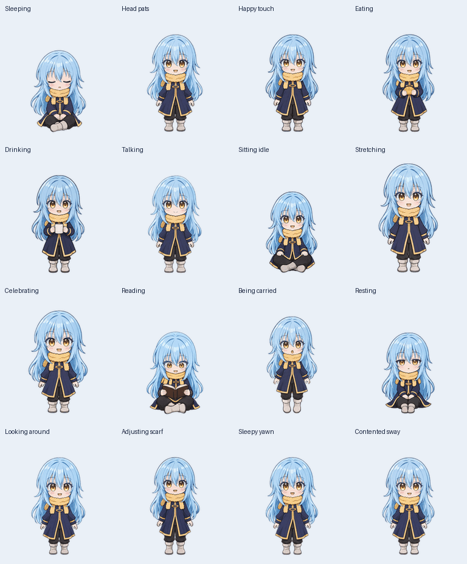

# Rimuru desktop companion (VPetR)

An English Rimuru companion built on VPet, maintained in [TheApple05/VPetR](https://github.com/TheApple05/VPetR).

This upgrade adds **21 animation pose families and 129 frames**, dedicated interactions, and a reusable PNG frame cache that reduces repeated allocation during playback.

See the **[Rimuru build, launch, and validation guide](Rimuru/README.md)** for the Windows app, character mod, source artwork, previews, packaging tools, and native checks.

VPet's existing license and attribution are preserved. The [original English guide](README_en.md), [license](LICENSE), and other translated documentation remain available. Changes for this version belong in TheApple05/VPetR.
