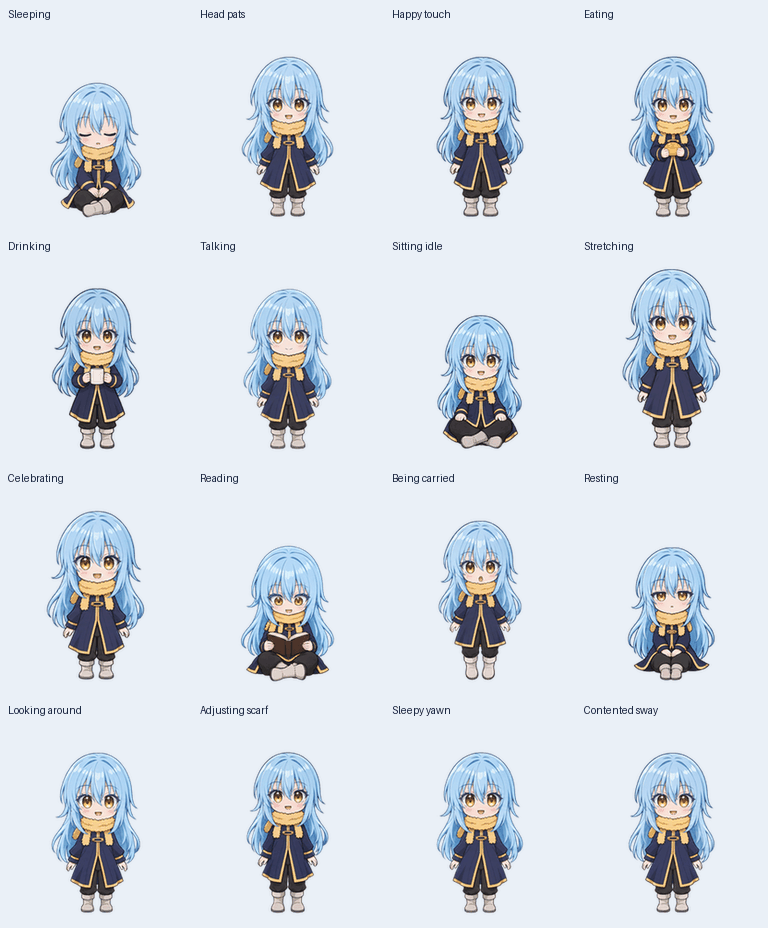

# Rimuru desktop companion

An English Rimuru character and animation upgrade for [TheApple05/VPetR](https://github.com/TheApple05/VPetR). The generated artwork includes 21 pose families, 129 exported PNG frames, and 106 native animation definitions.

New loops cover sleeping, head and body pats, eating, drinking, talking, sitting, stretching, celebrating, studying, carrying, and resting. Movement, waving, jumping, focused work, waiting, and inspection remain available. English is the default language and Rimuru is the default character.



## Build and run

Use Windows x64, the .NET 10 SDK, and Python 3.10 or newer. From the repository root:

```powershell
python -m pip install -r .\Rimuru\requirements.txt
powershell -ExecutionPolicy Bypass -File .\Rimuru\Build-Rimuru.ps1
.\Rimuru\Launch-Rimuru.cmd
```

The self-contained build is written to `Rimuru/dist/Rimuru-VPet`. The builder exports the checked-in artwork and includes the required Core assets. It preserves existing settings in the selected output folder. `-UseStandardAtlas` uses the nine-state atlas without the additional directional look rows; native desktop animations stay available.

To use just the character, copy `VPet-Simulator.Windows/mod/0100_rimuru` into another VPet installation's `mod` folder, enable **Rimuru Companion**, select **Rimuru**, choose **English**, and restart. That installation still needs its normal Core module.

## Automatic updates

On each normal launch, the app checks stable `rimuru-v` releases from **TheApple05/VPetR** in the background. New Windows portable downloads are verified against GitHub's SHA-256 digest and installed after all instances in this folder close normally. The next launch uses the update. Settings, saves, and other mods are preserved; replaced application files are backed up in the Windows temporary folder, and copy failures trigger rollback. Offline checks leave the installed version usable.

Create an empty `disable-auto-updates.txt` beside the executable to turn off checks. Update results are written to `rimuru-update.log`. Diagnostic launches skip updates. Version 2.0.0 needs a one-time upgrade to 2.1.0 to gain this feature.

## Native checks

The WPF check program tests frozen-frame reuse, playback restarts, idle eviction, source-change invalidation, truncated-cache recovery, and disposal. Its mod check resolves 196 mood/action combinations and plays all 21 pose families through the real native renderer.

```powershell
New-Item -ItemType Directory -Force .\Rimuru\dist\checks | Out-Null
dotnet run --project .\Rimuru\tests\RimuruChecks -c Release -p:CETCompat=false -- .\VPet-Simulator.Windows\mod\0100_rimuru\pet\rimuru\frames\idle .\Rimuru\dist\checks\cache.json
dotnet run --project .\Rimuru\tests\RimuruChecks -c Release -p:CETCompat=false -- --mod .\VPet-Simulator.Windows\mod\0100_rimuru .\Rimuru\dist\checks\native.json
```

Local Windows checks passed. In one controlled 30-second idle comparison after warmup, CPU usage fell from 1.85% to 0.60% of one core and mean private memory from 357.5 to 128.8 MiB. The focused 20,000-frame lookup check fell from 216.1 to 16.3 ms and from 11.84 MB allocated to 328 bytes. These are local measurements, not guarantees; startup did not improve.

`scripts/Measure-Rimuru.ps1` measures an isolated build. Run it only against a disposable profile: diagnostics write files beside the executable. Keep movement and simulation settings identical between comparisons. `scripts/package_delivery.py` creates portable and character ZIPs from the default build output, excludes saves and caches, and checks the archive's integrity.

## Artwork and scope

The source atlas, generated strips, extracted frames, pose hashes, and previews are included. Original private reference photos and account-specific ChatGPT Pets records are excluded. The optional strip extraction and base-atlas preview helpers require the installed Pets plugin; building from the checked-in frames does not.

Eating and drinking use one bread roll and mug across their corresponding items. Wall climbing and full Steam integration are outside the validated scope. The ChatGPT Pet sprite format remains the original nine animation states and sixteen look directions; the extra twelve loops are native desktop animations.

This fork retains VPet's existing [license](../LICENSE) and attribution. See the [upstream English guide](../README_en.md) for the original project's documentation. Development and contributions for this version go only to TheApple05/VPetR.
